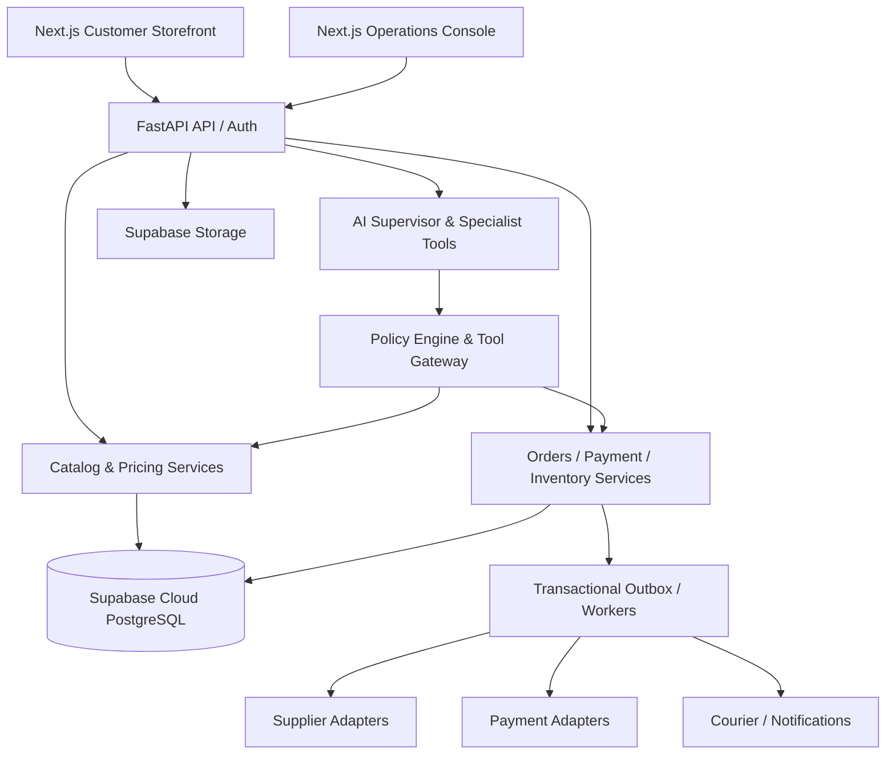

# AACP — Technical Architecture

## Architecture decision
**All application backend and transaction/business rules in Python (FastAPI)**. Frontend is Next.js + TypeScript. Database is Supabase-hosted PostgreSQL, using SQLAlchemy/psycopg in backend service. Future background workers use a durable outbox + task queue; agent framework is optional and cannot bypass permissioned Python service tools.

## Responsibility boundaries
- FastAPI: business logic, state machines, authorization, quote validation, idempotency and integrations.
- Next.js: responsive accessible UI and customer interaction; no privileged Supabase keys.
- Supabase: managed Postgres, Auth/Storage optionally; RLS and access isolation enforced.
- Agents: scoped typed calls, grounded answers, tool budgets and human escalation.
- Events: DB outbox with dedup/reconciliation, retry-after-failure.
- Suppliers: provider-agnostic interfaces for search, quote, hold (if available), submit PO, status and tracking.
- Payments: checkout sessions, verified webhooks, settlement and refund interface. No local simulator in production.

## SaaS expansion
Future control plane for tenants, entitlements, subscriptions and metering. Keep merchant business data and provider credentials isolated. Prefer dedicated commerce projects/deployments initially; shared tenancy later after testing DB RLS, app authorization, storage, logs and vector retrieval.

## Development-to-production gap
Current scaffold exposes **read-only demo catalog and simulated assistant**. Checkout, supplier order submission, payments, authentication, migrations deployment and durable workers are intentionally unfinished. README and UI label them accordingly.
